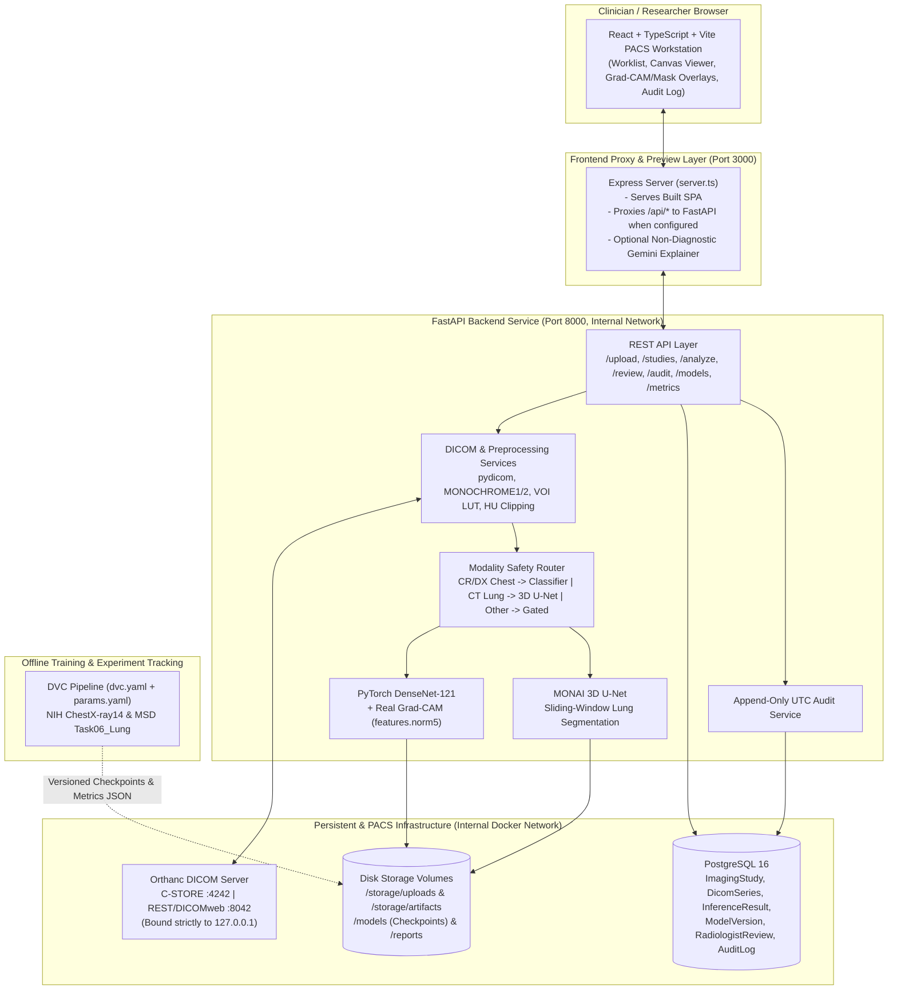

# System Architecture — MedVision AI

## High-Level System Diagram

## Architectural Principles

1. **Separation of Structured Metadata and Binary Imaging Artifacts**:
   - PostgreSQL stores relational metadata (`ImagingStudy`, `DicomSeries`, `InferenceResult`, `ModelVersion`, `RadiologistReview`, `AuditLog`).
   - Raw DICOM files, PNG slice previews, Grad-CAM heatmaps, and segmentation masks are stored on filesystem volumes (`STORAGE_DIR`) referenced by path—never as large database BLOBs.
2. **Strict Modality Gating**:
   - Models explicitly declare supported modalities (`CR/DX` vs `CT`), anatomies (`CHEST/THORAX/LUNG`), input formats, and source datasets.
   - Unsupported modalities (e.g., Brain MRI prior to BraTS registration) are gracefully gated as `unsupported_modality` rather than silently pushed through an incompatible network.
3. **Zero Synthetic Predictions**:
   - When trained checkpoints (`models/densenet121_nih14.pth` or `models/monai_unet3d_task06_lung.pth`) are absent, inference raises `ModelWeightsUnavailableError` and records `weights_unavailable`.
   - Demo Mode studies are strictly isolated via `isDemo: true` and explicitly labeled as illustrative examples.
4. **Immutable Audit Trail**:
   - Every ingestion, DICOM parse, inference attempt, Grad-CAM export, approval, rejection, and review-status change appends a new UTC-timestamped row to `audit_logs`. Historical records are never overwritten.
5. **Security Boundaries**:
   - Orthanc HTTP/DICOM interfaces are bound to `127.0.0.1` and authenticated via environment credentials.
   - Upload filenames are sanitized and path-resolved strictly inside `STORAGE_DIR` to eliminate path traversal and Zip-Slip attacks.
